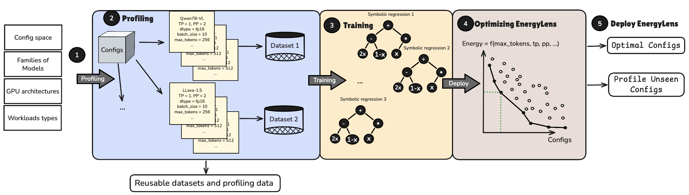

# EnergyLens

Code and data for **EnergyLens: Interpretable Closed-Form Energy Models for Multimodal LLM Inference Serving**.

[](https://anonymous.4open.science/w/energylens-AEB4/)



EnergyLens predicts the GPU energy of LLM inference served with vLLM across tensor-parallel (TP)
and pipeline-parallel (PP) layouts. Symbolic regression discovered the template once; for a new model,
its 12 parameters are fitted from about 50 measured batches, and the fitted formula ranks every layout.

This repository contains:

- the profiler that produced the measurements (NVIDIA through Zeus/NVML, Intel through Level Zero Sysman, AMD through amdsmi);
- every measured batch;
- the scripts behind each table and figure;
- the project page with an interactive explorer.

## Repository layout

```
nvidia/                 A100 profiler, EnergyLens model, evaluation and figures
  main_profiler.py      profiling entry point (grid, Azure trace and online-replay modes)
  source/               profiler internals; energy via Zeus (NVML), or Level Zero on Intel
  validate_results.py   validity checks applied to every dataset before use
  sr_training.py        symbolic-regression search that produced the template (PySR)
  test/                 evaluation scripts (one per table / experiment, see below)
  viz/                  paper figures; viz/datasets.py lists every dataset the figures use
  results_zeus*/        measured data (CSV), see "Data"
docker/                 Dockerfile for the AMD MI100 build environment
SETUP.md                environment setup for NVIDIA, Intel and AMD
intel/                  Intel GPU Max 1550 profiler (same pipeline, XPU backend)
  vllm_xpu_patches.diff vLLM changes needed on Intel XPU
  results_intel/       measured data (CSV)
adaptive_sampling/      profiling-cost study: which and how many rows to measure (simulator, D-optimal design)
data/
  build_dataset.py      exports all CSVs to Parquet for the Hugging Face Hub
  DATASET_CARD.md       dataset card (becomes the Hub README)
  azure_traces/         small Azure LLM inference trace samples
docs/                   project page (GitHub Pages) and its data export
```

## Installation

The analysis needs only CPU and standard scientific Python:

```bash
pip install -r requirements.txt
```

To re-run the measurements on NVIDIA, Intel or AMD GPUs, see [SETUP.md](SETUP.md).

To profile new models, use an environment with vLLM 0.16 and Zeus. `requirements-profiler-nvidia.txt`
pins the exact versions we used. On Intel GPUs, apply `intel/vllm_xpu_patches.diff` to vLLM.

## Data

All measurements are in the repository as the profiler wrote them (about 25 MB of CSV), so every script
runs offline:

| Folder | Content |
|---|---|
| `nvidia/results_zeus/` | A100 grids: 18 model/modality/precision runs (dense, MoE, state-space, hybrid; text, image, video; FP16, bitsandbytes NF4, AWQ, GPTQ, W8A8) |
| `nvidia/results_zeus_maxgen/` | Re-profiled multimodal grids that also record the longest output per batch |
| `nvidia/results_zeus_inlen/` | Five dense models over input length (prompts of 128 to 4,096 tokens; `in_all` merges them) |
| `nvidia/results_zeus_8gpu/` | The four 8-GPU layouts (1x8, 2x4, 4x2, 8x1) of Llama-3.1-8B, Mistral-7B, Qwen2.5-14B, Qwen2.5-32B and Llama-3.1-70B |
| `nvidia/results_vidur/` | Vidur's simulated batch latency for the Llama-3.1-8B and Llama-3.1-70B grids |
| `nvidia/results_zeus_trace/` | Real Azure request batches (held-out evaluation) |
| `nvidia/results_zeus_online/`, `nvidia/results_zeus_online_day/` | Live replay of Azure traffic against every layout (60 s pilot and one-day replay) |
| `nvidia/results_amd/` | AMD Instinct MI100 grids (Mistral-7B, Llama-3.1-8B; TP 1 and 2) |
| `intel/results_intel/` | Intel GPU Max 1550 grids (one rank per tile) |

Each `profiling_metrics.csv` has one row per measured batch:

- the layout: `tensor_parallel_size`, `pipeline_parallel_size`;
- the vLLM settings: `max_num_batched_tokens`, `max_num_seqs`;
- the workload: `batch_size`, `max_tokens`, `input_length`, plus image/video fields;
- the measurement: `latency` (s), `power` (W), `energy` (J per request, i.e. the batch's energy divided by the batch size), `n_gpus_measured`, `power_source`.

A consolidated Parquet version, with a validity flag per row, is built with:

```bash
python data/build_dataset.py          # -> data/hf/grid.parquet, data/hf/online_day.parquet, README.md
```

The output folder is ready to upload as a Hugging Face dataset.

The full Azure traces (about 2 GB) are not included. They are public in the
[Azure Public Dataset](https://github.com/Azure/AzurePublicDataset) (`AzureLLMInferenceTrace_{code,conv}_1week.csv`).
Download them into `data/azure_traces/` to re-run the trace and live-replay profiling.

## Reproducing the paper

Run the scripts from `nvidia/` unless noted otherwise. Outputs go to `nvidia/results_figures/`.

| Result | Command |
|---|---|
| Accuracy of EnergyLens vs MaverIQ and ML baselines (MAPE, held-out scenarios) | `python test/compare_cross_model.py` |
| Layout ranking: pairwise accuracy, Top-1, regret, LOCO | `python test/pairwise_ranking.py` |
| Seed variance (± in the tables) | `python test/seed_variance.py` |
| Ranking stays correct despite absolute error | `python test/ranking_vs_mape.py`, `python test/action_gap.py` |
| Batch-size and output-length extrapolation | `python test/test_latency_cross_batch.py` |
| Prediction without measured power | `python test/test_mean_power_accuracy.py` |
| Real Azure request batches | `python test/trace_eval.py --grid <grid csv> --trace <trace csv>`, `python test/plot_trace.py` |
| Distribution shift and cross-model transfer | `python test/shift_transfer.py` |
| Day-long live replay: layout selection policies | `python test/online_eval.py --online results_zeus_online_day/run_online_<model>_fp16 ...`, then `python test/policy_eval.py results_figures/online_run_online_*` |
| Intel GPU Max 1550 (accuracy, card correction, comparison with A100) | `python test/intel_eval.py`, `python viz/intel.py` |
| AMD Instinct MI100 (accuracy, TP cost, transfer from A100) | `python test/amd_eval.py`, `python viz/amd.py` |
| Quantized checkpoints | `python viz/quantized.py`; choosing checkpoint and layout under an MMLU limit: `python test/quant_selection.py` |
| MaverIQ reimplementation check | `python test/maveriq_reproduction.py` |
| Characterization figures (TP/PP, power, Pareto) | `python viz/characterization.py` |
| Ablation of the template's terms | `python test/ablation.py` |
| Fitted-parameter stability; log-linear and log-feature Gradient Boosting baselines | `python test/phi_and_baselines.py` |
| Layout choice without and with a latency limit | `python test/selection_baselines.py` |
| Fit on at most 4 GPUs, predict the 8-GPU layouts | `python test/gpu8_extrapolation.py` |
| Gaussian-process and two-stage (latency x power) baselines | `python test/more_baselines.py`, `python test/more_baselines_extrap.py` |
| Sample efficiency (box plots of MAPE and Top-1 versus training rows) | `python test/sample_efficiency.py`, `python viz/sample_efficiency.py` |
| Vidur (simulated latency, its own A100 operator profiles) | simulate: `VIDUR_DIR=<vidur clone> VIDUR_PYTHON=<python with vidur> python test/vidur_baseline.py --grid <grid csv>`; score the shipped simulations: `python test/vidur_eval.py --grid results_zeus/run_text_only_Llama-3.1-8B-Instruct_fp16/res_native/profiling_metrics.csv --vidur results_vidur/vidur_latency_llama3.1-8b.csv`, and for the 70B `--grid results_zeus_8gpu/run_text_only_Llama-3.1-70B-Instruct_fp16/res_native/profiling_metrics.csv --vidur results_vidur/vidur_latency_llama3.1-70b.csv --tp 1 2 4 8` |
| Evaluation figures | `python viz/evaluation.py` |
| Profiling cost: random vs D-optimal designs, equal-cost comparison with MaverIQ | `cd adaptive_sampling && python run.py --all && python profiling_cost.py && python equal_cost.py` |
| Symbolic-regression search for the template | `python sr_training.py --help` (needs PySR) |

Use `--help` on any script to see its options. Most accept `--datasets` to restrict the run to some datasets.
Seeds are fixed in the scripts (42, 7 and 123 for ranking; five seeds for MAPE).

Two experiments need GPUs and are not reproducible from the CSVs alone:
- the kernel-time breakdown of FP16, bitsandbytes and AWQ (`test/kernel_profile.py`);
- live adaptive profiling (`adaptive_sampling/live_profiler.py`).

## Using EnergyLens on your own model

```python
import sys; sys.path.insert(0, "nvidia/test"); sys.path.insert(0, "adaptive_sampling")
from simulator import load_csv
from compare_cross_model import fit_unified, unified_predict

df = load_csv("path/to/profiling_metrics.csv")         # validated rows of a profiling run
theta = fit_unified(df.sample(50, random_state=0))     # 12 parameters from 50 measured batches
df["predicted_energy"] = unified_predict(theta, df)    # J per request for every row / layout
```

To collect the 50 rows, run the profiler on a new model (`python nvidia/main_profiler.py --help`).
Alternatively, use the D-optimal design in `adaptive_sampling/strategies.py` to choose which configurations to measure.

## Project page

`docs/` holds the project page, a static site published with GitHub Pages:

- `index.html`: the page, including the interactive explorer;
- `assets/`: the figures;
- `data/site.json` and `data/site.js`: the explorer's data (the same content; the page loads the `.js`), regenerated with `python docs/build_site_data.py` after the data changes.

## License

Code: Apache-2.0 (see `LICENSE`). Data: CC BY 4.0 (see `data/DATASET_CARD.md`).
